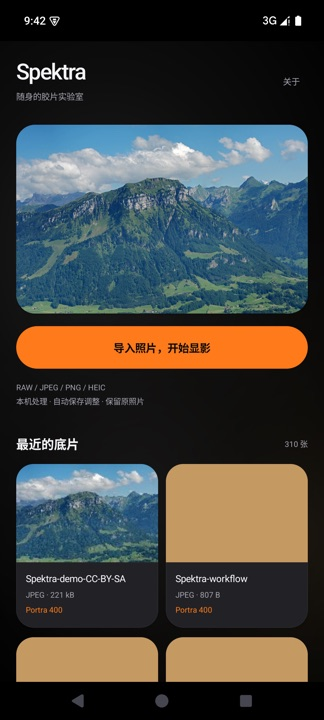
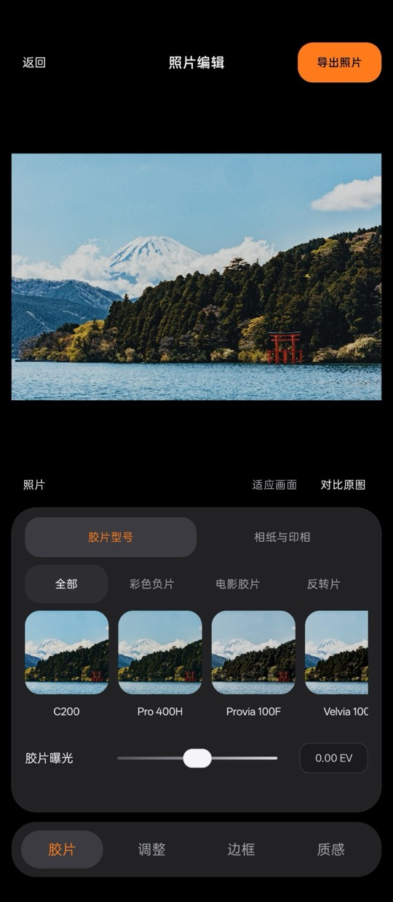
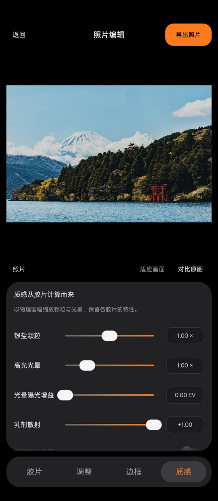
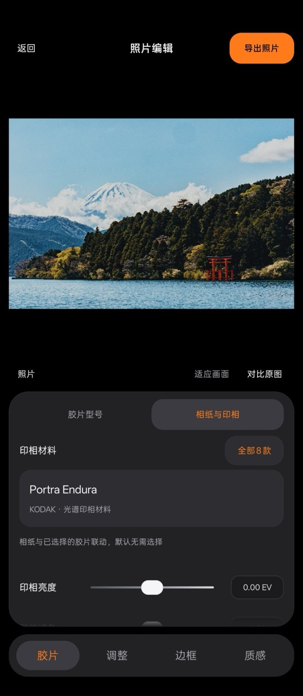
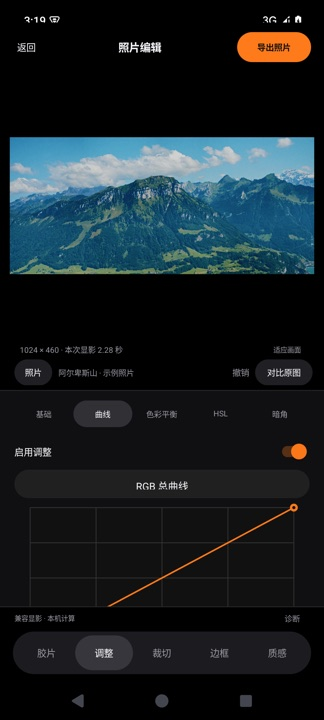
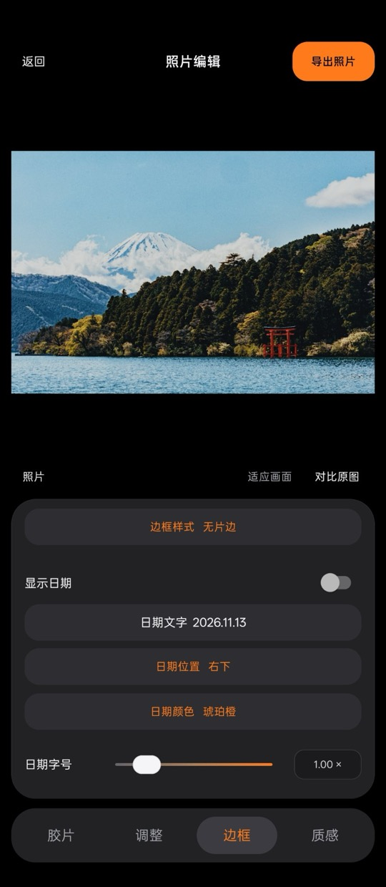
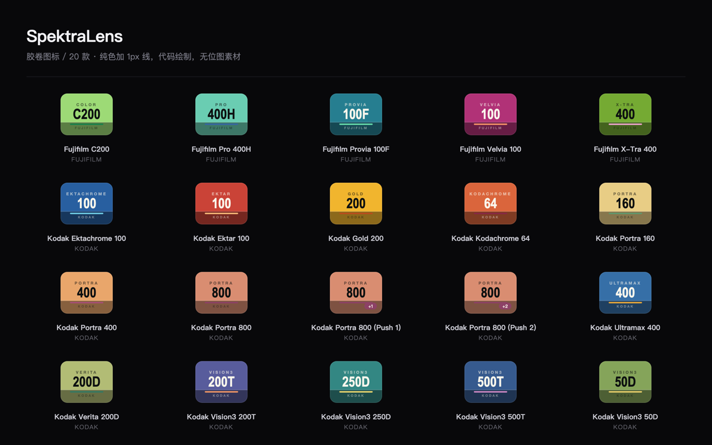
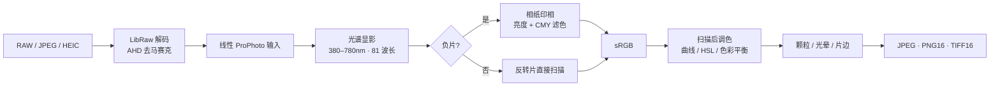

# SpektraLens

**把一间光谱胶片实验室装进口袋。**

[](CHANGELOG.md)
[](#兼容性)
[](#工作原理)
[](#为什么不是滤镜)
[](LICENSE)

SpektraLens 是一个**本地运行的光谱胶片模拟器**。它不复用任何预设滤镜或 LUT，而是把真实胶片的光谱响应曲线搬进手机：380–780 nm、每 5 nm 一个采样点、共 81 个波长，逐波长积分感光层、染料层与相纸的响应，再还原成 sRGB 图像。

RAW 解码、光谱显影、调色、颗粒与光晕合成、编码写盘全部在设备端完成。**没有服务器、没有账号、不上传照片。**

<p align="center">
  
  
  
</p>

---

## 为什么不是滤镜

| | 常见胶片滤镜 | SpektraLens |
|---|---|---|
| 原理 | 3×3 矩阵或 LUT 查表 | 81 波长光谱积分，物理胶片模型 |
| 数据 | 制作者反复调色试出的近似 | 上游实测胶片光谱密度数据，未修改 |
| 结果 | 换一张照片就失准 | 曝光、光源色温、胶片型号各自独立作用 |
| 处理位置 | 常需上传云端 | 全程在手机 GPU / CPU 上计算 |

## 界面

<p align="center">
  
  
  
</p>
<p align="center">
  <sub><b>首页</b> 导入或继续最近的底片 · <b>胶片</b> 20 款胶片与胶片曝光 · <b>相纸</b> 8 款印相材料与滤色</sub>
</p>

<p align="center">
  
  
  
</p>
<p align="center">
  <sub><b>调整</b> 曲线 / HSL / 色彩平衡 / 暗角 · <b>边框</b> 齿孔、白边、即时相纸与日期 · <b>质感</b> 颗粒、光晕与物理画幅</sub>
</p>

> 截图取自 v0.3.3；v0.3.5 起应用统一更名为 SpektraLens，界面与交互未变。

## 功能

**胶片与相纸**

- 20 款彩色胶片：Kodak Portra 160/400/800（含 Push 1 / Push 2）、Ektar 100、Gold 200、Ultramax 400、Ektachrome 100、Kodachrome 64、Vision3 50D/200T/250D/500T、Verita 200D；Fujifilm C200、Pro 400H、X-Tra 400、Provia 100F、Velvia 100
- 8 款相纸与拷贝片：Kodak Endura / Supra / Ultra / Portra Endura、Ektacolor Edge、Vision 2383 / Premier 2393、Fujifilm Crystal Archive Type II
- 负片走完整印相链路（亮度 + 洋红/黄色滤色），反转片直接扫描；切换胶片自动联动推荐相纸与分类

<p align="center">
  
  <br/>
  <sub>20 款胶卷图标全部由 Canvas 代码绘制，无位图素材</sub>
</p>

**显影与调色**

- 基础：曝光、对比度、亮度、阴影/高光、黑白场、饱和度、冷暖与色调
- 曲线：RGB、亮度、R/G/B 共 5 组，点击加点、拖动调整、长按删点
- 色彩平衡（四区）、HSL 八色分色、暗角
- 整组扫描调色可一键旁路，便于对比原始显影结果

**质感与呈现**

- 银盐颗粒、高光光晕、光晕增益、乳剂散射、防光晕层、显影耦合、密度曲线、镜头/扫描柔化、相纸炫光与预闪
- 物理画幅（135 / 120 等）、自动测光（默认关闭，可手动开启）
- 片边：135 黑色/暖色齿孔、白边、即时相纸，编号与英文题注，日期位置/颜色/字号/亮度可调

**输入与输出**

- RAW：`.DNG` `.NEF` `.RAF` `.ARW` 等，LibRaw 原尺寸 AHD 去马赛克，使用传感器数据而非内嵌预览
- 普通：JPEG / PNG / HEIC 等系统解码格式
- 导出：sRGB JPEG（8 位 q96）、PNG / TIFF（16 位），从原文件重新显影、不放大小图；保留可读 EXIF 与 ICC，不复制 GPS
- 每张照片独立编辑记录，30 步会话撤销/重做；导出配方与输入输出 SHA-256 存档，便于复现

## 工作原理



显影在后端独立进程中执行：优先尝试设备 GPU，通过严格数值自检后启用；初始化超时或失败则切换到随包 SwiftShader CPU 驱动。两类后端使用同一份材料数据与着色器，切换后结果一致性由仪器测试比对。

## 技术栈

| 层 | 实现 |
|---|---|
| 应用 | Java，Android 10+（API 29+），64 位 |
| 引擎 | C++ / Vulkan compute，float32，35 个 GLSL compute shader |
| 光谱模型 | 380–780 nm，5 nm 步进，81 波长 |
| RAW | LibRaw 0.22.2（固定源码随仓库） |
| CPU 回退 | SwiftShader（双 ABI 预编译 + 完整源码 ZIP） |
| 构建 | Gradle 8.11.1 / AGP 8.9.2 / NDK 27.2.12479018 / CMake 3.22.1 |
| 体积 | APK 约 32 MB |

## 快速开始

```sh
git clone https://github.com/qing1989/SpektraLens.git
cd SpektraLens
git submodule update --init --recursive
git lfs install --local && git lfs pull   # 拉取 SwiftShader 源码包

export JAVA_HOME=/path/to/jdk17
export ANDROID_HOME=/path/to/Android/sdk
python3 scripts/build.py -PpublicBuild=true :app:assembleDebug
```

产物位于 `android/app/build/outputs/apk/debug/app-debug.apk`。

- 需要 JDK 17、Python 3.9+、Android SDK platform / build-tools 35
- 首次构建会校验基线、应用 `patches/android-gpu-v0.2.3.patch`、复制引擎数据并编译 shader，耗时较长
- 重建 CPU 兼容库：`python3 scripts/build_swiftshader.py`
- 设备仪器测试：`python3 scripts/device_tests.py`（含 DNG / NEF 原尺寸导出校验）

## 兼容性

| 项 | 说明 |
|---|---|
| 系统 | Android 10 及以上，arm64-v8a |
| GPU | Vulkan 1.1+；不可用时自动回退 CPU 渲染 |
| 预览 | 最长边 1024 |
| 导出 | 受可用内存与 Vulkan 缓冲上限约束，导出前按源像素估算，不足时提示重试而不静默缩图 |
| 暂未开放 | 裁切 / 旋转 / 拉直 / 翻转、局部蒙版、批量处理、黑白与 CineStill 配置、半格拼接 |

已知问题与逐版修正记录见 [CHANGELOG.md](CHANGELOG.md)；能力边界与实现细节见 [docs/](docs/)。

## 项目结构

```
android/          应用与 JNI 适配层
SpektraLab/       C++ / Vulkan 引擎（git submodule）
third_party/      LibRaw、SwiftShader 源码与预编译库
patches/          引擎侧 Android 适配补丁
scripts/          构建、打包、设备测试、资源校验
docs/             界面规范、显影对照、性能与兼容性记录
design/           启动图标与视觉设计稿
```

## 文档

- [胶片显影对照](docs/胶片显影对照.md) — 原始 Python / 桌面 Metal / Android Vulkan 三端数值核对
- [兼容显影实现](docs/兼容显影实现.md) — SwiftShader CPU 后端
- [移动 GPU 移植](docs/移动GPU移植.md) — 社区 GPU 代码的适配范围与差异
- [胶卷图标说明](docs/图标映射.md) — 20 款图标的绘制规则与清单
- [C 方案界面](docs/C方案界面.md) · [滑杆界面](docs/滑杆界面.md) — 视觉与交互规范
- [照片预览与资源校验](docs/照片预览与资源校验.md) — 手势、缩放与启动时资源校验
- [导出性能排查](docs/导出性能排查.md) — 逐阶段耗时与优化记录

## 致谢与许可

本项目的胶片模型、显影引擎与材料数据来自开源上游：

- [andreavolpato/spektrafilm](https://github.com/andreavolpato/spektrafilm) — 光谱胶片模型与原始 Python 实现
- [JamesQiu2005/SpektraLab](https://github.com/JamesQiu2005/SpektraLab) — C++ / Vulkan 引擎
- [SAINTTaiYi/SpektraLab-Android](https://github.com/SAINTTaiYi/SpektraLab-Android) — 移动 GPU 移植参考
- LibRaw — RAW 解码（LGPL-2.1）

程序与界面的 Android 适配层、扫描后处理、胶卷图标绘制代码按 **GPL-3.0-or-later** 发布。胶片与相纸测量数据沿用上游署名与许可（CC BY-SA 4.0），未作修改。

固定版本、完整署名与第三方许可见 [UPSTREAMS.md](UPSTREAMS.md)、[NOTICE](NOTICE)、[THIRD_PARTY_NOTICES.md](THIRD_PARTY_NOTICES.md)。

---

<sub>SpektraLens 是独立第三方项目，与 Kodak、Fujifilm 及其他商标持有人无隶属关系。胶片与相纸名称仅用于说明所模拟的材料。</sub>
