# SpektraLens

**把一间光谱胶片实验室装进口袋。**

[](CHANGELOG.md)
[](https://github.com/qing1989/SpektraLens/releases/latest)
[](#兼容性)
[](#工作原理)
[](#为什么不是滤镜)
[](LICENSE)
[](https://github.com/qing1989/SpektraLens/actions/workflows/android.yml)

SpektraLens 是一个**跑在手机上的光谱胶片模拟器**。它不做 3×3 矩阵近似，也不查 LUT，而是把真实胶片的光谱响应搬进设备：380–780 nm、每 5 nm 一个采样点、共 81 个波长，逐波长积分感光层、染料层与相纸的响应，再还原成 sRGB 图像。

RAW 解码、光谱显影、相纸印相、裁切调色、颗粒与光晕合成、观片台排版与编码写盘全部在设备端完成。**没有服务器、没有账号、不上传照片**；只有检查更新和下载新版本时会联网。

<p align="center">
  <b>25</b> 款胶片 &nbsp;·&nbsp; <b>9</b> 款相纸 &nbsp;·&nbsp; <b>81</b> 个波长 &nbsp;·&nbsp; <b>0</b> 次上传
</p>

<p align="center">
  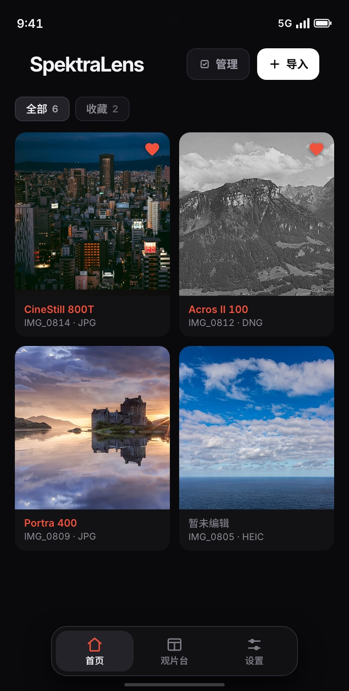
  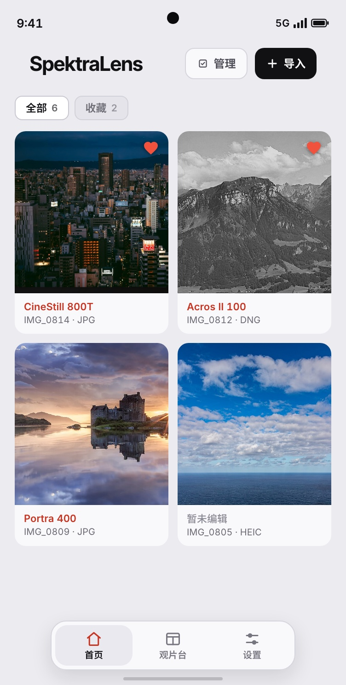
  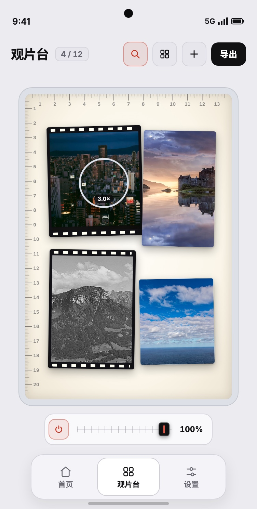
</p>
<p align="center">
  <sub><b>暗房黑</b> 哑光黑零偏色修图 &nbsp;·&nbsp; <b>明室阳极银</b> 日间高对比明室主题 &nbsp;·&nbsp; <b>观片台</b> 透光齿孔、3× 放大镜与悬浮开关调光</sub>
</p>

---

## 为什么不是滤镜

| | 常见胶片滤镜 | SpektraLens |
|---|---|---|
| 原理 | 3×3 矩阵或 LUT 查表 | 81 波长光谱积分，物理胶片模型 |
| 数据 | 制作者反复调色试出的近似 | 上游实测胶片光谱密度数据，未修改 |
| 结果 | 换一张照片就失准 | 曝光、光源色温、胶片型号各自独立作用 |
| 处理位置 | 常需上传云端 | 全程在本机 GPU / CPU 上计算 |

## 界面

<p align="center">
  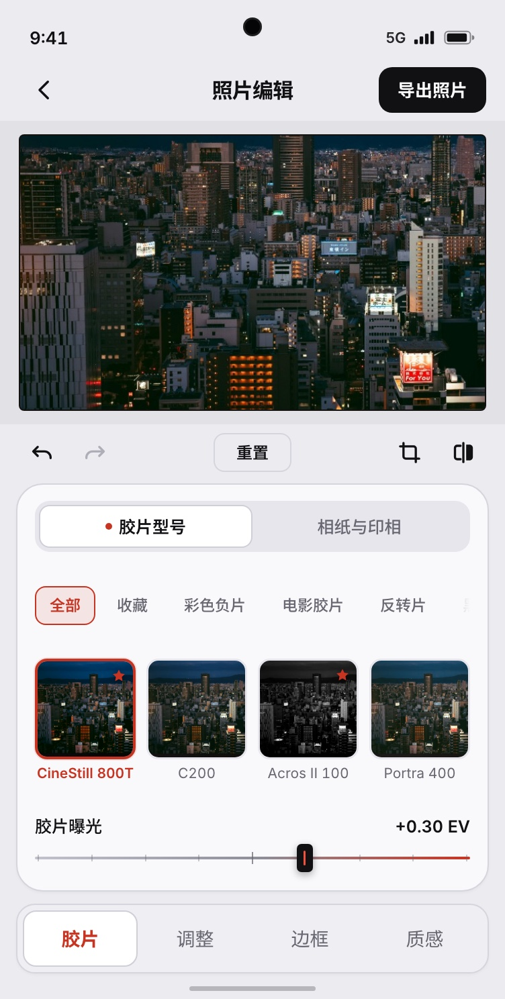
  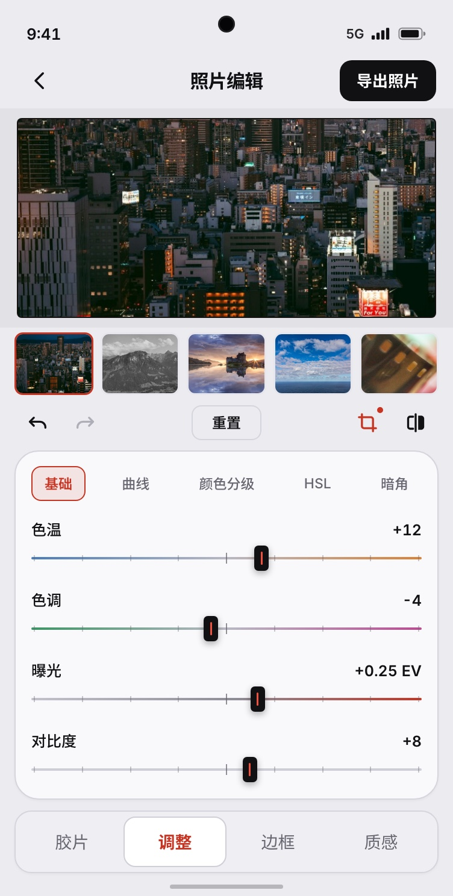
  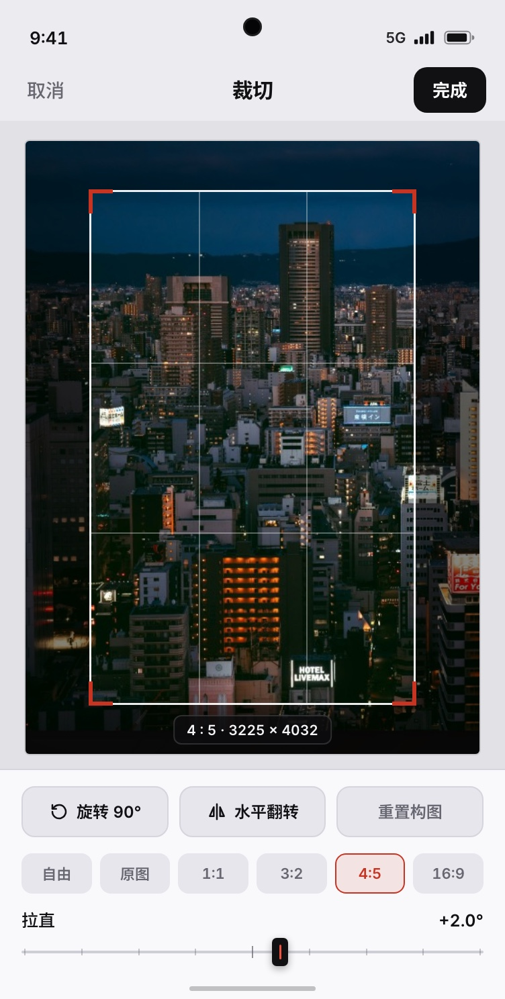
</p>
<p align="center">
  <sub><b>胶片</b> 25 款实时显影画廊与长按收藏 &nbsp;·&nbsp; <b>调整</b> 全宽游标滑块、快速切图条与曲线 / HSL &nbsp;·&nbsp; <b>裁切</b> 全屏拉直、常用比例、旋转与翻转</sub>
</p>

<p align="center">
  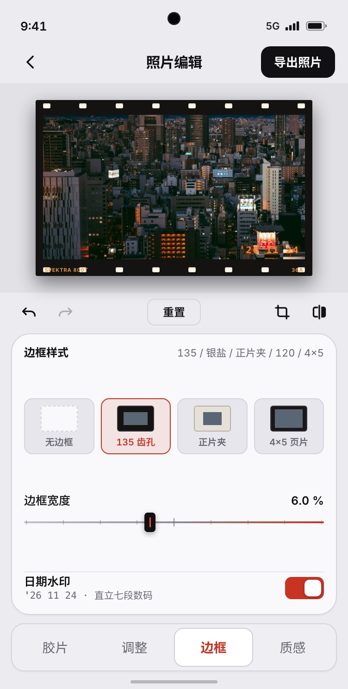
  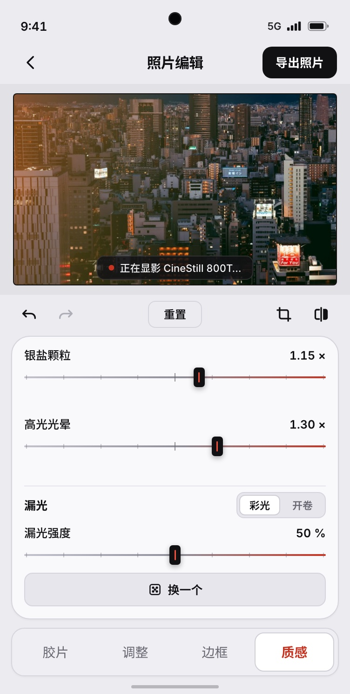
  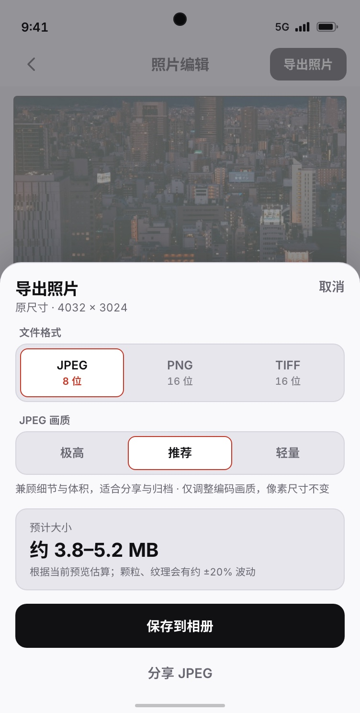
</p>
<p align="center">
  <sub><b>边框</b> 8 款拟真胶片片边与直立七段日期 &nbsp;·&nbsp; <b>质感</b> 银盐颗粒、光晕与彩光 / 开卷漏光 &nbsp;·&nbsp; <b>导出</b> JPEG / PNG16 / TIFF16 与体积估算</sub>
</p>

<p align="center">
  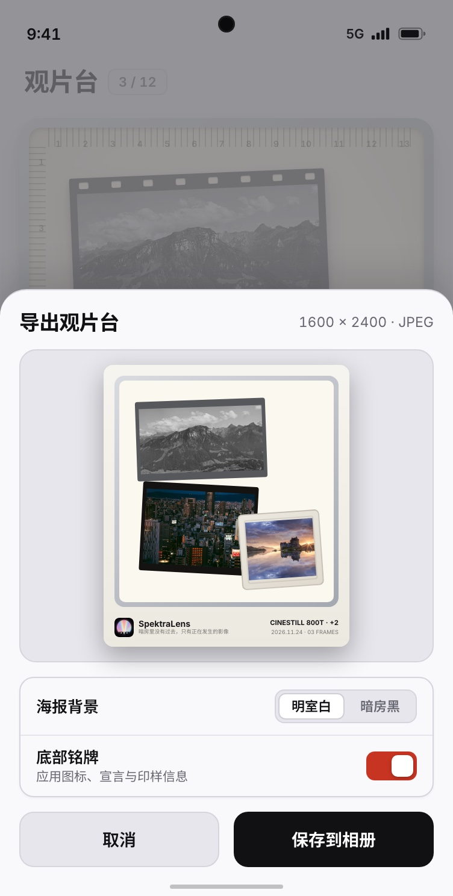
  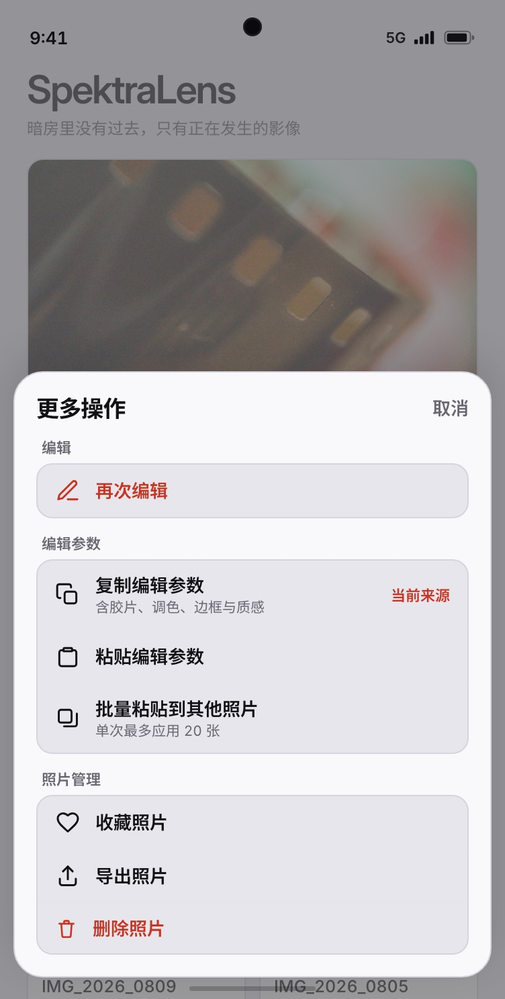
  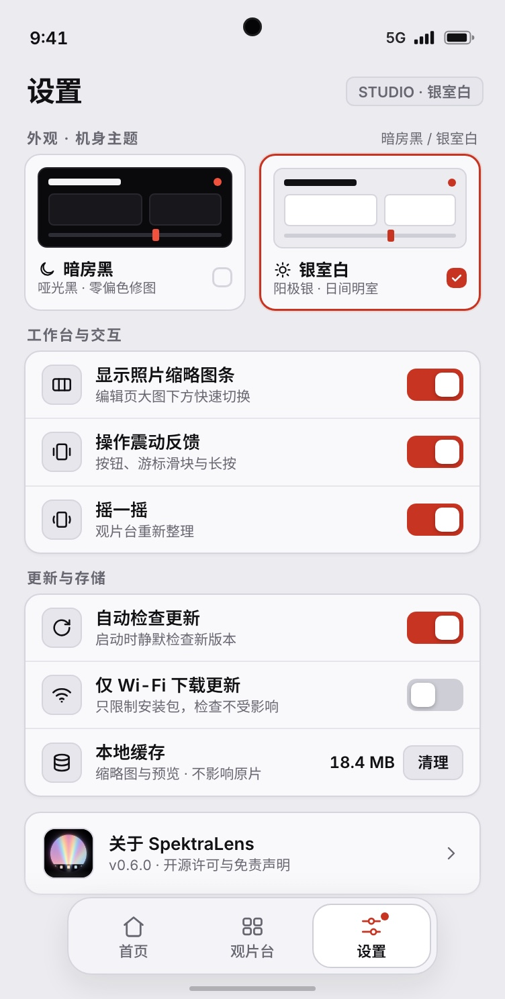
</p>
<p align="center">
  <sub><b>印样海报</b> 1600×2400 明室白 / 暗房黑与底部铭牌 &nbsp;·&nbsp; <b>长按操作</b> 复制与最多 20 张批量粘贴 &nbsp;·&nbsp; <b>设置</b> 双主题切换、交互开关与缓存管理</sub>
</p>

> 界面预览取自 `v0.6.0` 确认版设计稿，与正式版视觉与交互保持一致。

## 功能

**精密光学界面与双主题**

- 全应用支持「暗房黑」与「明室阳极银」即时切换，无需重启，覆盖全部页面、编辑面板与底部浮层
- 一级页面采用底部 3-Tab 悬浮导航（首页 / 观片台 / 设置），原地切换；观片台选中照片或开启放大镜时自动变形为单行上下文操作条
- 全新设置页：集中管理机身主题、编辑页快速切图条、操作震动反馈、观片台摇一摇整理、自动检查更新、仅 Wi-Fi 下载、本地缓存一键清理与关于页

**观片台**

- 独立 2:3 实体灯箱工作台，保留 1/5/10 mm L 形蚀刻厘米标尺，一次最多摆放 12 张照片自由拖动、双指缩放、旋转与叠放
- 135 胶片边框照片自动使用真实透明齿孔，灯光从齿孔与片基自然透出
- 内置 3× 光学玻璃放大镜检视局部细节；支持「摇一摇」或一键自动整理版面，越界拖动带阻尼震动与弹性回弹
- 底部 38dp 极简悬浮开关灯与 15%–100% 无级调光胶囊，配备物理机械开关音效、光学棘轮滴答声与触感反馈；关灯态拖动游标即可唤醒点亮
- 支持导出 `1600×2400` 高清印样海报：导出前实时预览，可切换「明室白 / 暗房黑」海报背景与「底部铭牌」（应用图标、宣言、主胶片型号、日期与张数）

**胶片与相纸**

- 21 款彩色胶片：Kodak Portra 160 / 400 / 800（含 800 Push 1、Push 2）、Ektar 100、Gold 200、Ultramax 400、Ektachrome 100、Kodachrome 64、Vision3 50D / 200T / 250D / 500T、Verita 200D、CineStill 800T；Fujifilm C200、Pro 400H、X-Tra 400、Provia 100F、Velvia 100
- 4 款黑白胶片：Kodak Tri-X 400、T-Max 100、Fujifilm Neopan 100 Acros II、Ilford HP5 Plus 400，附带六项镜头滤镜与五档相纸反差；颗粒强度按各胶片上游值校准
- 9 款相纸与拷贝片：Kodak Professional Endura Premier / Supra Endura / Ultra Endura / Portra Endura、Ektacolor Edge、Vision 2383 / Premier 2393、Fujifilm Crystal Archive Type II、Ilford Multigrade IV RC
- 重构高光渲染：8 款彩色相纸默认开启上游标定扩展动态范围，黑白银盐相纸采用线性高光肩部舒展，亮部自然过渡不再发灰
- 负片走完整印相链路（亮度 + 洋红 / 黄色滤色），反转片直接扫描；切换胶片时相纸与分类自动联动
- CineStill 800T 带无防光晕层的高光余量，可在「质感」中调整 0–8 EV
- 胶片画廊缩略图按当前照片现场显影，长按胶片卡片即可收藏并在「收藏」分类快速筛选

**照片库与批量操作**

- 极简双列画廊，支持「全部 / 收藏」快速筛选；最近导入或确认保存的照片自动置顶，未保存退出保留原位
- 从系统相册或文件选择器多选导入 JPG / PNG / HEIC / HEIF / DNG，单次最多 20 张；超大相册按 400 行分页加载，不阻塞界面；HEIC / JPEG 动态照片自动提取静态帧
- 照片管理支持全选 / 取消选择与批量删除，删除先写库、失败整体回滚；收藏状态与编辑记录持久化
- 长按照片打开操作面板：开始 / 再次编辑、复制参数、单张粘贴、批量粘贴（上限 20 张）、收藏、直接导出、删除

**裁切、显影与调色**

- 全屏裁切与拉直：支持自由构图、原图及 `1:1`、`3:2`、`4:5`、`16:9` 等常用比例，支持 90° 旋转、水平 / 垂直翻转与精细角度拉直
- 基础调色：曝光、对比度、亮度、阴影 / 高光、黑白场、饱和度、色温与色调；全宽精密游标滑块双击恢复单项默认值，支持 30 步会话撤销 / 重做
- 进阶调色：RGB / 亮度 / R / G / B 五组曲线（点击加点、拖动调整、长按删点）、四区色彩平衡、HSL 八色分色与暗角；支持一键旁路对比原始显影结果
- 编辑页支持开启 5 列最近照片快速切图条（切换自动保存当前参数与显影小图并保留视角）；单击大图快速收起 / 展开面板，单指长按预览原图

**质感、边框与漏光**

- 银盐颗粒、高光光晕、光晕曝光增益、乳剂散射、防光晕层、显影耦合、密度曲线、镜头 / 扫描柔化、相纸炫光与预闪
- 物理画幅（135 / 120 等）、自动测光（默认关闭，可手动开启）
- 「彩光」与「开卷」两种随机漏光样式，支持调节强度与一键「换一个」随机分布，并可自然延伸到 135 胶片片基
- 8 款拟真胶片边框：135 齿孔（黑色 / 暖色）、135 银盐黑白、35mm 档案正片夹、120 中画幅、4×5 大画幅、白色留边、即时相纸，可显示编号与题注；附带直立切角七段数码日期水印（位置、颜色、字号与亮度可调）

**输入与输出**

- RAW：`.DNG` `.NEF` `.RAF` `.ARW` 等，LibRaw 原尺寸 AHD 去马赛克，使用传感器数据而非内嵌预览
- 普通：JPEG / PNG / HEIC / HEIF 等系统解码格式
- 导出：sRGB JPEG（8 位，极高 95 / 推荐 90 / 轻量 85 三档）、PNG / TIFF（16 位），每次从原文件重新显影，不放大小图；保留可读 EXIF（含实际焦距与 35mm 等效焦距）与 ICC，不复制 GPS
- 原尺寸导出为默认；5000 万像素等大图内存不足时，先算出安全长边并经用户确认，再按有界尺寸导出，完整保留调色、裁切、片边与日期
- 导出前给出预计文件体积，导出进度条可随时取消；每张照片保留独立配方与输入输出 SHA-256 存档

**应用内更新**

- 启动时后台静默检查固定 Release 清单；发现兼容新版本时在「设置」Tab 与关于页提示，按 `versionCode` 判断新旧
- 更新说明保留分组与逐条换行，长内容可滚动、底部操作按钮固定；下载带进度、可取消、安装前强制校验 SHA-256 并走系统安装确认
- 只有一个用途的联网：检查与下载更新。照片始终留在本机

## 工作原理

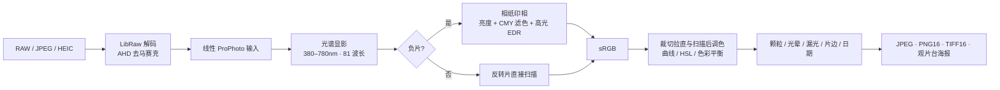

显影在独立进程中执行：优先尝试设备 GPU，通过严格数值自检后启用；初始化超时或失败则切换到随包 SwiftShader CPU 驱动。两类后端使用同一份材料数据与着色器，切换后结果一致性由仪器测试比对。画廊缩略图在私有显影进程中按卡片密度解码源图（384–512 px），经 64 MiB 磁盘缓存与 16 MiB 内存 LRU 复用，滚动不重复显影；主预览固定 1024 px，导出始终读原图。

## 技术栈

| 层 | 实现 |
|---|---|
| 应用 | Java，Android 10+（API 29+），64 位 |
| 引擎 | C++ / Vulkan compute，float32，36 个 GLSL compute shader |
| 光谱模型 | 380–780 nm，5 nm 步进，81 波长 |
| RAW | LibRaw 0.22.2（固定源码随仓库） |
| CPU 回退 | SwiftShader（双 ABI 预编译 + 完整源码 ZIP） |
| 构建 | Gradle 8.11.1 / AGP 8.9.2 / NDK 27.2.12479018 / CMake 3.22.1 |
| 体积 | APK 约 33.8 MB |

## 下载安装

从 [Releases](https://github.com/qing1989/SpektraLens/releases/latest) 下载最新 `SpektraLens-v0.6.0.apk`（约 33.8 MB）：

- 要求 Android 10+、arm64 设备；允许「安装未知来源应用」后直接安装
- 装好之后可以直接在应用内更新：「设置 → 关于 SpektraLens → 检查更新」，不必再访问网页
- **0.4.0 起改用正式签名。0.3.9 及更早的 debug 签名版本无法覆盖安装，需先卸载旧版；卸载会删除应用内图库、导入副本与编辑记录，请提前导出重要照片并保留原片。**
- 0.4.0 之后的正式版本沿用同一把签名密钥，可直接覆盖安装并完整保留图库、收藏、观片台与编辑记录
- 每个版本的 SHA-256 与变更说明见对应 Release 页面；发版步骤见[应用内更新与发版](docs/应用内更新与发版.md)

## 从源码构建

```sh
git clone https://github.com/qing1989/SpektraLens.git
cd SpektraLens
git submodule update --init --recursive
git lfs install --local && git lfs pull   # 拉取 SwiftShader 源码包

export JAVA_HOME=/path/to/jdk17
export ANDROID_HOME=/path/to/Android/sdk
python3 scripts/build.py -PpublicBuild=true :app:assembleDebug
```

产物位于 `android/app/build/outputs/apk/debug/app-debug.apk`。

- 需要 JDK 17、Python 3.9+、Android SDK platform / build-tools 35
- 首次构建会校验基线、应用 `patches/android-gpu-v0.2.3.patch`、复制引擎数据并编译 shader，耗时较长
- 重建 CPU 兼容库：`python3 scripts/build_swiftshader.py`
- 设备仪器测试：`python3 scripts/device_tests.py`（含 DNG / NEF 原尺寸导出校验）

## 兼容性

| 项 | 说明 |
|---|---|
| 系统 | Android 10 及以上，arm64-v8a |
| GPU | Vulkan 1.1+；不可用时自动回退 CPU 渲染 |
| 预览 | 最长边 1024 |
| 导出 | 默认原尺寸；内存不足时按可用内存反算安全长边，经确认后导出较小尺寸，不静默缩图 |
| 暂未开放 | 局部蒙版、批量导出、半格拼接、折叠屏分栏适配（规划中） |

已知问题与逐版修正记录见 [CHANGELOG.md](CHANGELOG.md)；能力边界与实现细节见 [docs/](docs/)。

## 项目结构

```
android/          应用与 JNI 适配层
SpektraLab/       C++ / Vulkan 引擎（git submodule）
third_party/      LibRaw、SwiftShader 源码与预编译库
patches/          引擎侧 Android 适配补丁
scripts/          构建、打包、设备测试、资源校验
docs/             界面规范、显影对照、性能与兼容性记录
design/           启动图标与视觉设计稿
```

## 文档

- [胶片显影对照](docs/胶片显影对照.md) — 原始 Python / 桌面 Metal / Android Vulkan 三端数值核对
- [黑白胶片](docs/黑白胶片.md) — 四款黑白胶片、银盐相纸与镜头滤镜的接入规则
- [观片台可行性评估](docs/观片台可行性评估.md) — 实体灯箱、透光齿孔、3× 放大镜与品牌印样海报
- [收藏、设置与首页导航](docs/收藏、设置与首页导航.md) — 3-Tab 导航、双主题设置页与胶片收藏
- [最近照片与批量导入](docs/最近照片与批量导入.md) — 导入、照片管理与批量粘贴
- [编辑页交互](docs/编辑页交互.md) · [滑杆界面](docs/滑杆界面.md) — 编辑工作流、全屏裁切与游标滑块规范
- [胶片画廊与缩略图](docs/胶片画廊与缩略图.md) · [缩略图性能优化](docs/缩略图性能优化.md) — 有界解码、缓存与失效规则
- [兼容显影实现](docs/兼容显影实现.md) — SwiftShader CPU 后端
- [移动 GPU 移植](docs/移动GPU移植.md) — 社区 GPU 代码的适配范围与差异
- [配色与字体](docs/配色与字体.md) · [胶卷图标说明](docs/图标映射.md) — 视觉规范与 25 款胶卷图标清单
- [照片预览与资源校验](docs/照片预览与资源校验.md) — 手势、缩放与启动时资源校验
- [导出性能排查](docs/导出性能排查.md) — 逐阶段耗时与优化记录
- [应用内更新与发版](docs/应用内更新与发版.md) — 清单格式、校验与发版记录

## 致谢与许可

本项目的胶片模型、显影引擎与材料数据来自开源上游：

- [andreavolpato/spektrafilm](https://github.com/andreavolpato/spektrafilm) — 光谱胶片模型与原始 Python 实现
- [JamesQiu2005/SpektraLab](https://github.com/JamesQiu2005/SpektraLab) — C++ / Vulkan 引擎
- [SAINTTaiYi/SpektraLab-Android](https://github.com/SAINTTaiYi/SpektraLab-Android) — 移动 GPU 移植参考
- LibRaw — RAW 解码（LGPL-2.1）

程序与界面的 Android 适配层、扫描后处理、胶卷图标绘制代码按 **GPL-3.0-or-later** 发布。原始 spektrafilm 胶片与相纸测量数据沿用上游署名与 **CC BY-SA 4.0** 许可（仅作用于 profiles / LUT 本身，用户拍摄与导出的成品照片不受 CC BY-SA 4.0 约束）；SpektraLab 黑白胶片、相纸与 CineStill 800T alias 产品数据原样复制并保留原始 NOTICE。所有上游数据均未作修改。

固定版本、完整署名与第三方许可见 [UPSTREAMS.md](UPSTREAMS.md)、[NOTICE](NOTICE)、[CITATION.cff](CITATION.cff)、[THIRD_PARTY_NOTICES.md](THIRD_PARTY_NOTICES.md)。

---

<sub>SpektraLens 是独立第三方项目，并非 spektrafilm、SpektraLab 或胶片厂商的官方版本，与 Kodak、Fujifilm、Ilford 及其他商标持有人无隶属或联名关系。胶片与相纸名称仅用于说明所模拟的材料。</sub>
